I design and build software products end to end: the interface people use, the architecture underneath it, and the design system that keeps the two in agreement. Based in Córdoba, Spain.

### 今 · now

Leading product design as chief design officer at [Hagalink](https://hagalink.es), where I look after how the whole product line reads and behaves.

### 心 · how I work

I start at the interface and work backwards into the architecture, because the constraints that decide a system show up first in what someone actually touches. Every project I work on carries its design system in writing, so the decisions outlive the conversation that produced them.

