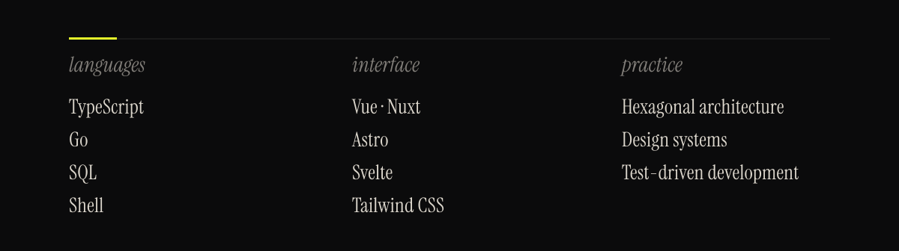

I design and build software products end to end: the interface people use, the architecture underneath it, and the design system that keeps the two in agreement. Based in Córdoba, Spain.

### Now

- Leading product design at [Hagalink](https://hagalink.es) as Chief Design Officer, across the company's SaaS work.
- Building **freakdays**, a gamified tracker for anime and manga collections.
- Maintaining **freakfy**, a self-hosted player for anime soundtracks.

### Selected work

| Project | What it is | Built with |
| --- | --- | --- |
| [freakdays](https://github.com/alvaroofernaandez/freakdays) | Gamified life management for geeks: workouts, manga and anime collections, daily quests, and a release calendar. | TypeScript, Vue, Nuxt, PostgreSQL |
| [freakfy](https://github.com/alvaroofernaandez/freakfy) | Self-hosted static music player for anime soundtracks. | Go, Astro, Svelte, Tailwind CSS |

### Elsewhere

- [hagalink.es](https://hagalink.es), the studio I build with
- [@hagalink](https://github.com/hagalink) on GitHub
